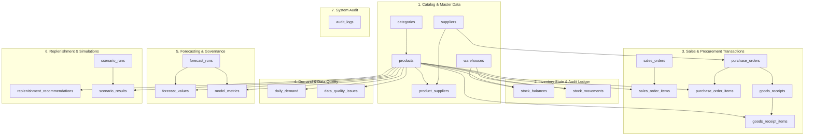

# StockSense: Unified PostgreSQL 18 Database Architecture & Specification

**Course**: Advanced Database Systems · Semester Project Implementation  
**Engine**: PostgreSQL 18 (Port `5432`, Database: `stocksense`)  
**Architecture Model**: Hybrid Transactional / Analytical Processing (HTAP)  
**Schema Normalization**: Boyce-Codd Normal Form (BCNF) · 22 Tables  

---

## 1. Purpose, Working & Functioning of the `database/` Folder

The `database/` directory serves as the **authoritative physical foundation** of the StockSense platform:

```
database/
└── postgres/
    └── 01_schema.sql    # Authoritative PostgreSQL 18 production DDL script
```

### Why Declarative DDL Instead of Dynamic ORM?
In enterprise software engineering, application code (Python/SQLAlchemy) should **never dynamically generate or mutate database schemas on the fly**. Dynamic ORM migrations frequently miss check constraints, lack specialized index tuning, and introduce schema drift. 

Instead, StockSense relies on a version-controlled **Data Definition Language (DDL)** script:
* **Declarative Single Source of Truth**: All data types, precision constraints (e.g., `NUMERIC(12,4)`), composite primary keys, foreign key cascading behaviors, and mathematical check constraints are explicitly declared in SQL.
* **Idempotent Execution**: The script uses `CREATE TABLE IF NOT EXISTS` and `CREATE INDEX IF NOT EXISTS`. It can be safely executed against a fresh or existing database without causing runtime errors or corrupting state.
* **Management & Provisioning**: The script is provisioned directly through **pgAdmin 4** on the PostgreSQL service (`postgresql-x64-18` on port `5432`). It guarantees that all database rules and constraints are enforced at the database engine level prior to any application interaction.

---

## 2. Detailed PostgreSQL Database Schema: The 7 Clusters & 22 Tables

All 22 tables have been strictly normalized to **Boyce-Codd Normal Form (BCNF)**. For every functional dependency $X \to Y$, the determinant $X$ is a superkey, eliminating all update, insertion, and deletion anomalies.



---

### Detailed Table Specifications by Cluster

### Cluster 1: Catalog & Master Data (Slow-Changing Dimensions)
Foundational master records defining SKUs, categories, vendor directories, and physical locations.

| Table Name | Primary Key | Foreign Keys | Key Columns & Constraints | Description & Role |
| :--- | :--- | :--- | :--- | :--- |
| **`categories`** | `category_id SERIAL` | None | `name VARCHAR(100) UNIQUE NOT NULL`, `description TEXT` | Hierarchical grouping of supermarket goods (Dairy, Produce, etc.). |
| **`products`** | `product_id SERIAL` | `category_id -> categories` | `sku UNIQUE NOT NULL`, `name`, `unit`, `cost_price DECIMAL(12,4)`, `selling_price DECIMAL(12,4)`, `reorder_threshold`<br/>**Constraints:**<br/>`CHECK (cost_price >= 0)`<br/>`CHECK (selling_price >= cost_price)` | Master product catalogue. Enforces positive margins at the engine level. |
| **`suppliers`** | `supplier_id SERIAL` | None | `name UNIQUE NOT NULL`, `contact_email`, `contact_phone` | Vendor directory with direct procurement contact details. |
| **`product_suppliers`** | `(product_id, supplier_id)` | `product_id -> products`<br/>`supplier_id -> suppliers` | `lead_time_days INT CHECK (lead_time_days >= 0)`, `minimum_order_qty`, `pack_size`, `is_primary BOOLEAN` | M:N relationship defining vendor lead time ($L$), minimum order quantities, and primary supplier designation. |
| **`warehouses`** | `warehouse_id SERIAL` | None | `name UNIQUE NOT NULL`, `location VARCHAR(255)` | Physical branch stores and regional distribution centers. |

---

### Cluster 2: Inventory State & Immutable Audit Ledger
The financial and operational heart of real-time inventory management.

| Table Name | Primary Key | Foreign Keys | Key Columns & Constraints | Description & Role |
| :--- | :--- | :--- | :--- | :--- |
| **`stock_balances`** | `(product_id, warehouse_id)` | `product_id -> products`<br/>`warehouse_id -> warehouses` | `on_hand_qty DECIMAL(12,4)`, `reserved_qty DECIMAL(12,4)`, `updated_at`<br/>**Constraint:**<br/>`CHECK (on_hand_qty >= reserved_qty)` | Real-time stock snapshot. Locked row-by-row (`SELECT ... FOR UPDATE`) during checkouts. |
| **`stock_movements`** | `movement_id BIGSERIAL` | `product_id -> products`<br/>`warehouse_id -> warehouses` | `movement_type VARCHAR(30)` (`SALE`, `DELIVERY`, `ADJUSTMENT`), `quantity_delta DECIMAL(12,4)` (signed), `reference_type`, `reference_id`, `occurred_at` | Append-only financial ledger. Enforces the invariant: $\text{Balance} \equiv \sum \Delta$. |

---

### Cluster 3: Sales & Procurement Transactions (OLTP)
Captures fast customer checkout receipts and inbound supplier purchasing contracts.

| Table Name | Primary Key | Foreign Keys | Key Columns & Constraints | Description & Role |
| :--- | :--- | :--- | :--- | :--- |
| **`sales_orders`** | `sales_order_id BIGSERIAL` | None | `order_number VARCHAR(64) UNIQUE`, `status`, `total_amount`, `created_at` | Customer order headers generated during checkout. |
| **`sales_order_items`** | `item_id BIGSERIAL` | `sales_order_id -> sales_orders`<br/>`product_id -> products` | `quantity DECIMAL(12,4) CHECK (quantity > 0)`, `unit_price`, `cost_price` | Itemized line records sold with price snapshots at the time of purchase. |
| **`purchase_orders`** | `purchase_order_id BIGSERIAL` | `supplier_id -> suppliers` | `po_number VARCHAR(64) UNIQUE`, `status` (`ORDERED`, `PARTIALLY_RECEIVED`, `COMPLETED`), `ordered_at`, `expected_at` | Formal procurement contracts issued to suppliers. |
| **`purchase_order_items`** | `po_item_id BIGSERIAL` | `purchase_order_id -> purchase_orders`<br/>`product_id -> products` | `quantity_ordered`, `quantity_received`, `unit_cost`<br/>**Constraint:**<br/>`CHECK (quantity_received <= quantity_ordered)` | Itemized order lines. Prevents over-delivery and fraudulent vendor billing. |
| **`goods_receipts`** | `receipt_id BIGSERIAL` | `purchase_order_id -> purchase_orders` | `delivery_note VARCHAR(100)`, `received_at` | Physical dock receiving events when trucks unload shipments. |
| **`goods_receipt_items`** | `receipt_item_id BIGSERIAL` | `receipt_id -> goods_receipts`<br/>`product_id -> products` | `quantity_received DECIMAL(12,4) CHECK (quantity_received > 0)` | Quantities inspected and transferred into on-hand physical stock. |

---

### Cluster 4: Analytical Daily Demand & Data Quality (OLAP & Cleansing)
Aggregates daily consumption patterns and audits data anomalies before model training.

| Table Name | Primary Key | Foreign Keys | Key Columns & Constraints | Description & Role |
| :--- | :--- | :--- | :--- | :--- |
| **`daily_demand`** | `(product_id, demand_date)` | `product_id -> products` | `quantity_sold DECIMAL(12,4)`, `stockout_flag BOOLEAN`, `data_status VARCHAR(25)` (`NORMAL`, `STOCKOUT_CENSORED`, `IMPUTED`) | Time-series sales volume. Explicitly tracks days where stock was 0. |
| **`data_quality_issues`** | `issue_id BIGSERIAL` | `product_id -> products` | `issue_type VARCHAR(50)`, `details TEXT`, `detected_at`, `status` (`FLAGGED`, `APPROVED_CORRECTION`, `IGNORED`), `resolution_note` | Audit trail of flagged anomalies (e.g. stockout-censored zeros) and imputation actions. |

---

### Cluster 5: Demand Forecasting & Model Governance (Time-Series & Statistics)
Manages statistical forecasting runs, predicted trajectories, and accuracy evaluations.

| Table Name | Primary Key | Foreign Keys | Key Columns & Constraints | Description & Role |
| :--- | :--- | :--- | :--- | :--- |
| **`forecast_runs`** | `forecast_run_id BIGSERIAL` | None | `model_name` (`NAIVE`, `SMA_7`, `SMA_14`, `HOLT_WINTERS`, `CROSTON`), `horizon_days`, `training_start`, `training_end`, `created_at` | Execution journal of statistical models and training date ranges. |
| **`forecast_values`** | `forecast_value_id BIGSERIAL` | `forecast_run_id -> forecast_runs`<br/>`product_id -> products` | `forecast_date DATE`, `predicted_demand`, `lower_bound`, `upper_bound`<br/>**Constraint:**<br/>`UNIQUE (forecast_run_id, product_id, forecast_date)` | Future demand projections with 95% statistical confidence intervals. |
| **`model_metrics`** | `metric_id BIGSERIAL` | `forecast_run_id -> forecast_runs`<br/>`product_id -> products` | `mae DECIMAL(10,4)`, `wape DECIMAL(10,4)`, `bias DECIMAL(10,4)`<br/>**Constraint:**<br/>`UNIQUE (forecast_run_id, product_id)` | Accuracy metrics: Mean Absolute Error, Weighted Absolute % Error, and Bias %. |

---

### Cluster 6: Replenishment Intelligence & What-If Simulations (Decision Support)
Generates explainable replenishment advice and models supply chain stress tests.

| Table Name | Primary Key | Foreign Keys | Key Columns & Constraints | Description & Role |
| :--- | :--- | :--- | :--- | :--- |
| **`replenishment_recommendations`** | `recommendation_id BIGSERIAL` | `product_id -> products` | `current_on_hand`, `current_on_order`, `lead_time_days`, `lead_time_demand`, `safety_stock`, `reorder_point`, `recommended_qty`, `stockout_risk_score` (0-100), `explanation_text`, `status` | Optimal inventory policies ($ROP = LTD + SS$) with plain-English and algebraic justification cards. |
| **`scenario_runs`** | `scenario_id BIGSERIAL` | None | `name VARCHAR(100)`, `demand_multiplier`, `lead_time_delta_days`, `safety_stock_factor`, `created_at` | What-If simulation headers (demand surge %, supplier delay days). |
| **`scenario_results`** | `result_id BIGSERIAL` | `scenario_id -> scenario_runs`<br/>`product_id -> products` | `simulated_stockout_risk`, `projected_ending_stock`, `estimated_holding_cost`, `estimated_lost_sales_cost`<br/>**Constraint:**<br/>`UNIQUE (scenario_id, product_id)` | Financial trade-off projections: Holding Cost vs. Lost Sales Margins. |

---

### Cluster 7: System Audit (Compliance & Security)

| Table Name | Primary Key | Key Columns & Role |
| :--- | :--- | :--- |
| **`audit_logs`** | `audit_id BIGSERIAL` | `user_id`, `action` (`CREATE`, `UPDATE`, `EXECUTE`), `entity_type`, `entity_id`, `details`, `created_at`. Tracks user actions and automated system events. |

---

## 3. Which Part of the Database Supports What Part of the Application?

| Application Page / Feature | Primary Tables Utilized | Internal Database Operations Performed |
| :--- | :--- | :--- |
| **Executive Dashboard (`/dashboard`)** | `products`, `stock_balances`, `replenishment_recommendations`, `daily_demand` | Fast indexed queries calculating active SKU totals, low-stock warnings, and average stockout risk. |
| **Products & Stock (`/products`)** | `products`, `categories`, `stock_balances`, `product_suppliers`, `suppliers` | Multi-table relational join displaying margins, unit types, live on-hand quantities, and primary supplier lead times. |
| **Point of Sale (`/pos`)** | `products`, `stock_balances`, `stock_movements`, `sales_orders`, `sales_order_items` | **Pessimistic Concurrency**: Executes `SELECT ... FOR UPDATE` on `stock_balances`, decrements stock atomically, appends an immutable `stock_movements` record, and creates the sales receipt. |
| **Demand Forecasting (`/forecasting`)** | `daily_demand`, `forecast_runs`, `forecast_values`, `model_metrics` | Queries 180 days of historical sales, fits statistical models (Holt-Winters weekly seasonality, Croston intermittent), and persists trajectories with 95% confidence bounds. |
| **Replenishment (`/replenishment`)** | `replenishment_recommendations`, `stock_balances`, `product_suppliers`, `purchase_orders` | Computes $LTD = \bar{D} \times L$, $SS = Z \cdot \sigma_D \cdot \sqrt{L}$, and $ROP = LTD + SS$. Subtracts open purchase orders (`current_on_order`) to prevent duplicate ordering. |
| **Data Quality (`/data-quality`)** | `daily_demand`, `stock_balances`, `data_quality_issues` | Scans for stockout-censored zeros (`quantity_sold == 0 AND on_hand_qty == 0`). Executes one-click rolling median imputation and updates the audit log. |
| **What-If Scenarios (`/simulation`)** | `scenario_runs`, `scenario_results`, `products`, `daily_demand`, `product_suppliers` | Runs Monte Carlo parameter sweeps under demand surges and shipping delays, estimating holding costs vs. lost sales margins. |
| **Query Plan Inspector (`/benchmark`)** | `daily_demand`, `stock_movements`, `stock_balances`, `products` | Executes native `EXPLAIN (ANALYZE, BUFFERS, VERBOSE)` queries. Profiles PostgreSQL's Cost-Based Optimizer, memory buffer hits, and Bitmap Index Scans. |

---

## 4. Which Part of the Database Stores What Type of Data?

```
┌────────────────────────────────────────────────────────────────────────┐
│                        PostgreSQL 18 ("stocksense")                    │
├─────────────────────────┬──────────────────────────────────────────────┤
│ Data Category           │ Tables Included                              │
├─────────────────────────┼──────────────────────────────────────────────┤
│ 1. Master Reference     │ categories, products, suppliers,             │
│    (Slow-Changing)      │ product_suppliers, warehouses                │
├─────────────────────────┼──────────────────────────────────────────────┤
│ 2. Real-Time State      │ stock_balances                               │
│    (Atomic Mutex)       │ (Locked row-by-row with SELECT FOR UPDATE)   │
├─────────────────────────┼──────────────────────────────────────────────┤
│ 3. Financial Ledger     │ stock_movements                              │
│    (Append-Only Audit)  │ (Signed quantity_delta: Balance == SUM delta)│
├─────────────────────────┼──────────────────────────────────────────────┤
│ 4. Transactional (OLTP) │ sales_orders, sales_order_items,             │
│    (High-Frequency)     │ purchase_orders, purchase_order_items,       │
│                         │ goods_receipts, goods_receipt_items          │
├─────────────────────────┼──────────────────────────────────────────────┤
│ 5. Analytical (OLAP)    │ daily_demand, data_quality_issues            │
│    (Time-Series Sales)  │ (180-day consumption history + flags)        │
├─────────────────────────┼──────────────────────────────────────────────┤
│ 6. Predictive Machine   │ forecast_runs, forecast_values,              │
│    Learning / Stats     │ model_metrics                                │
│                         │ (Forecast trajectories + confidence bands)   │
├─────────────────────────┼──────────────────────────────────────────────┤
│ 7. Prescriptive & Risk  │ replenishment_recommendations,               │
│    Intelligence         │ scenario_runs, scenario_results              │
│                         │ (Reorder policies, ROP math, What-If runs)   │
├─────────────────────────┼──────────────────────────────────────────────┤
│ 8. Compliance & Logs    │ audit_logs                                   │
└─────────────────────────┴──────────────────────────────────────────────┘
```

---

## 5. Core Mathematical & Architectural Invariants

### 1. Invariant I: Double-Entry Financial Ledger Reconciliation
Stock is never modified as an arbitrary number without a corresponding receipt. The database guarantees that:
$$\text{stock\_balances.on\_hand\_qty} \equiv \sum_{\text{all movements}} \text{stock\_movements.quantity\_delta}$$
- Every customer sale records a negative $\Delta$.
- Every delivery dock receipt records a positive $\Delta$.
- Running `GET /api/v1/inventory/reconcile` scans all SKUs and mathematically validates zero discrepancies.

### 2. Invariant II: Pessimistic Concurrency (Zero Overselling)
When 20 concurrent threads simultaneously attempt to buy the last 5 units of an SKU:
```sql
SELECT on_hand_qty, reserved_qty 
FROM stock_balances 
WHERE product_id = :prod_id AND warehouse_id = :wh_id 
FOR UPDATE;
```
The first 5 threads acquire row-level locks, execute checkouts, and decrement inventory atomically. The subsequent 15 threads read `on_hand_qty == 0` and are rejected with HTTP 400 (`Insufficient stock`). The final balance is guaranteed to stay at exactly `0.0000` (never negative).

### 3. Invariant III: Business Logic Integrity Checks
- **No Negative Profit Margins**: `CHECK (selling_price >= cost_price)`
- **No Negative Stock**: `CHECK (on_hand_qty >= reserved_qty)`
- **No Fraudulent Goods Receipts**: `CHECK (quantity_received <= quantity_ordered)`
- **No Negative Lead Times**: `CHECK (lead_time_days >= 0)`
